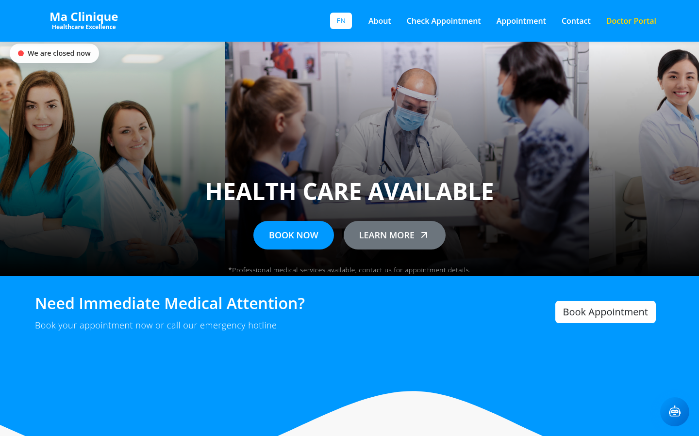
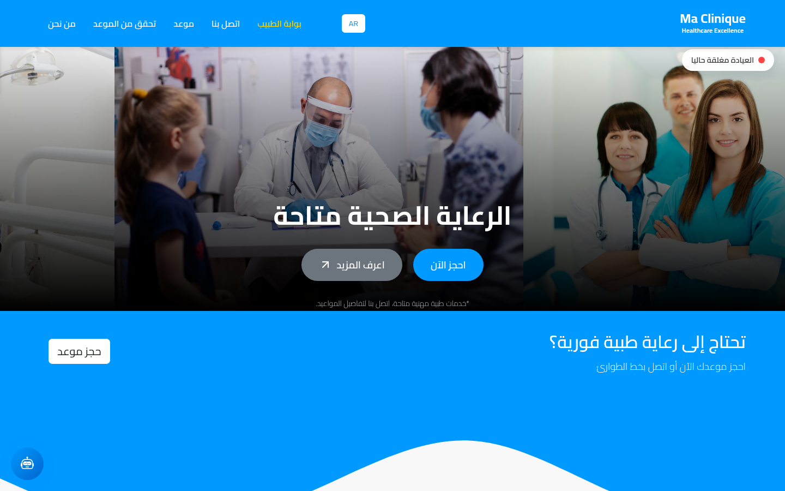
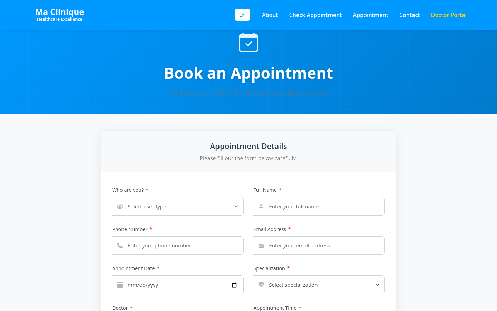
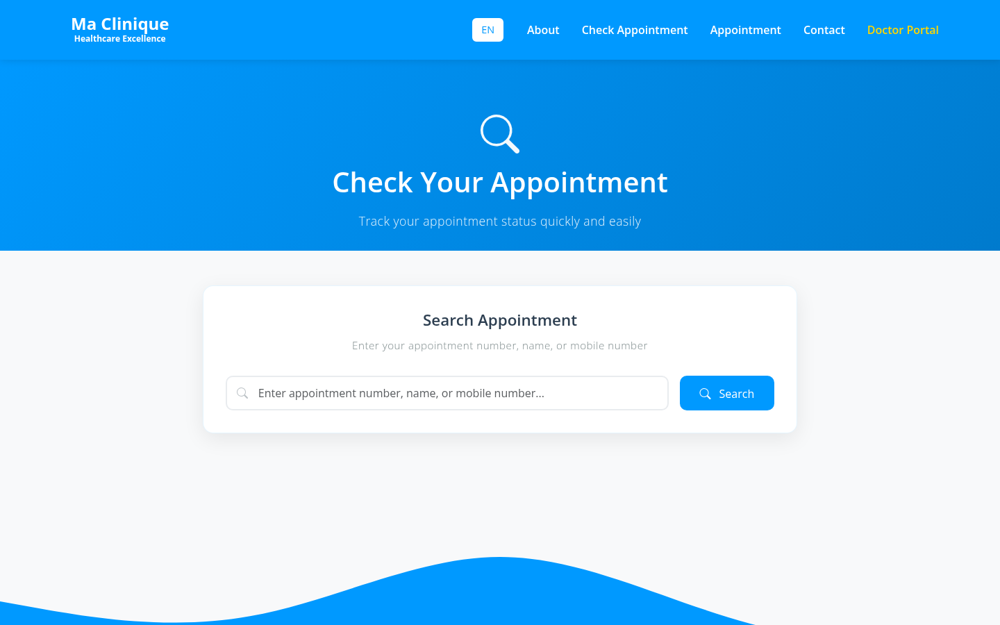
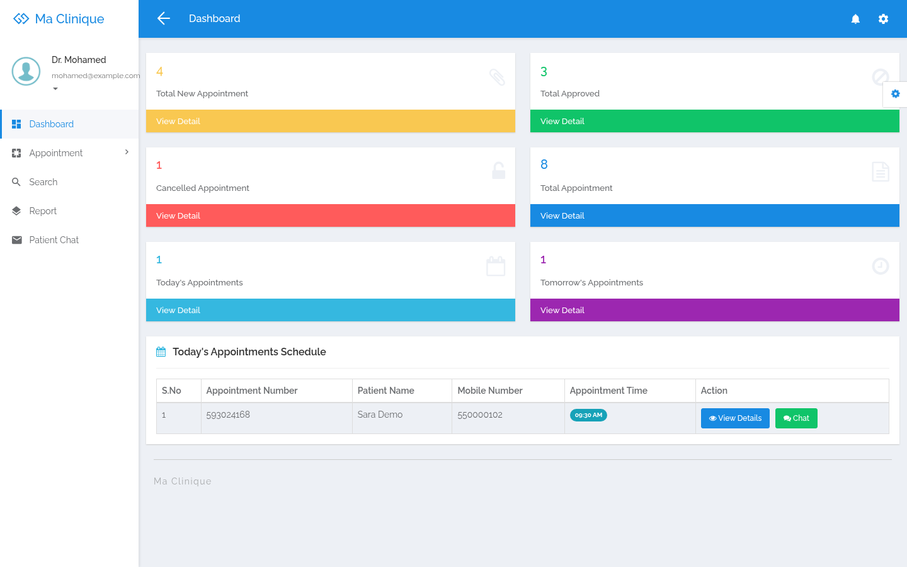
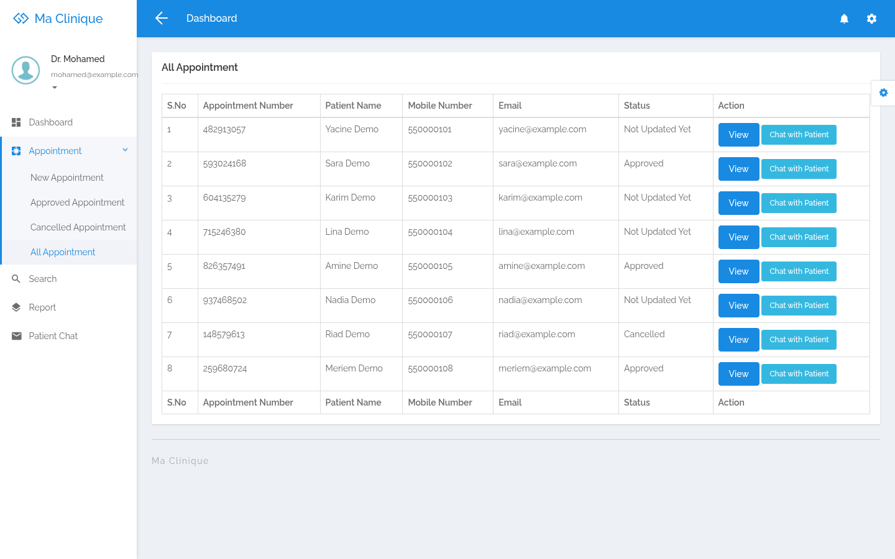
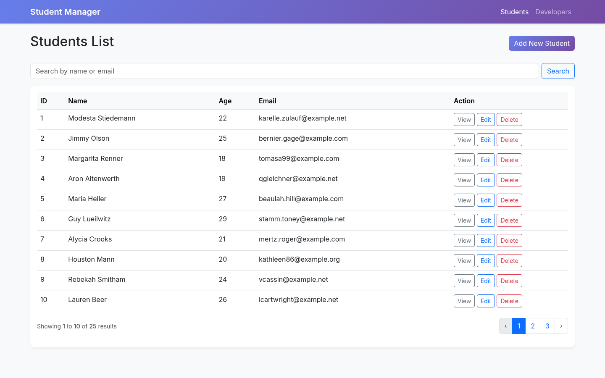
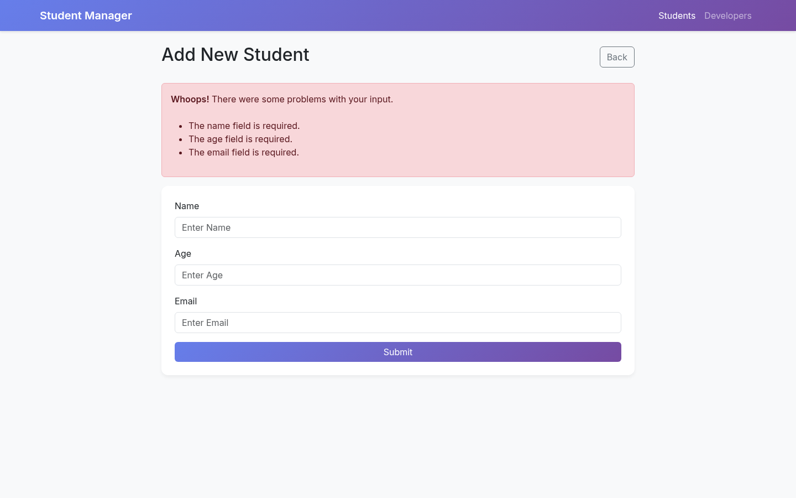
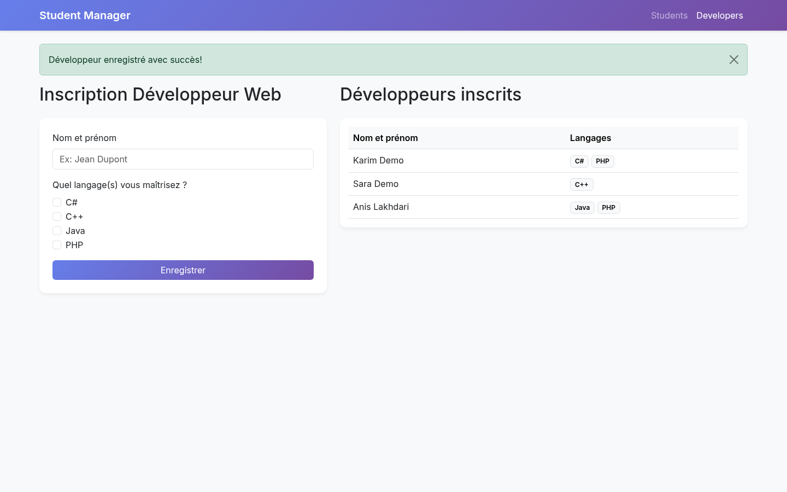
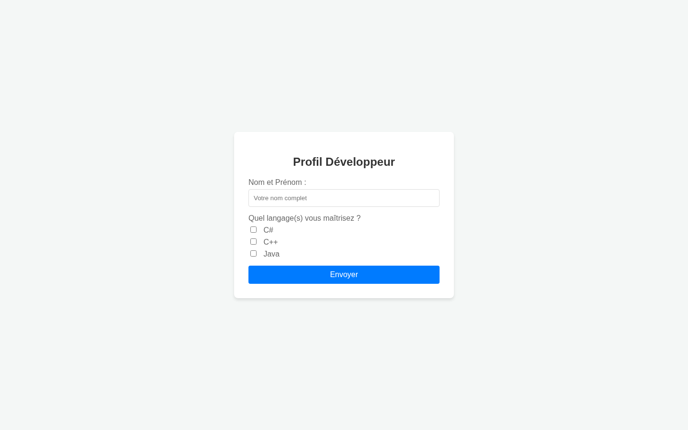

# PHP projects — Anis Charaf Eddine Lakhdari

| Project | What | Stack |
|---|---|---|
| [clinic-booking](clinic-booking/) | Medical appointment booking: online booking, doctor dashboard, REST API, real-time chat, AI assistant, English/French/Arabic | PHP 8, PDO, MySQL, jQuery, Bootstrap, Node.js, Socket.IO |
| [laravel-student-manager](laravel-student-manager/) | Student CRUD with search and pagination, plus a developer registration form, with feature tests | Laravel 12, Eloquent, Blade, PHPUnit |
| [php-pdo-form](php-pdo-form/) | Form with client- and server-side validation, saved with prepared statements | PHP, PDO, MySQL, jQuery |

## Run everything with Docker

```bash
cd laravel-student-manager && composer install && cd ..
docker compose up -d --build
```

- Clinic: http://localhost:8080/clinic-booking/ (doctor login: `mohamed@example.com` / `1234`)
- Plain PHP form: http://localhost:8080/php-pdo-form/
- Laravel app: http://localhost:8000

All names, phones and emails in the demo data are fake.

## Screenshots

### Clinic booking

| | |
|---|---|
|  |  |
|  |  |
|  |  |

### Laravel student manager

| | |
|---|---|
|  |  |
|  |  |
